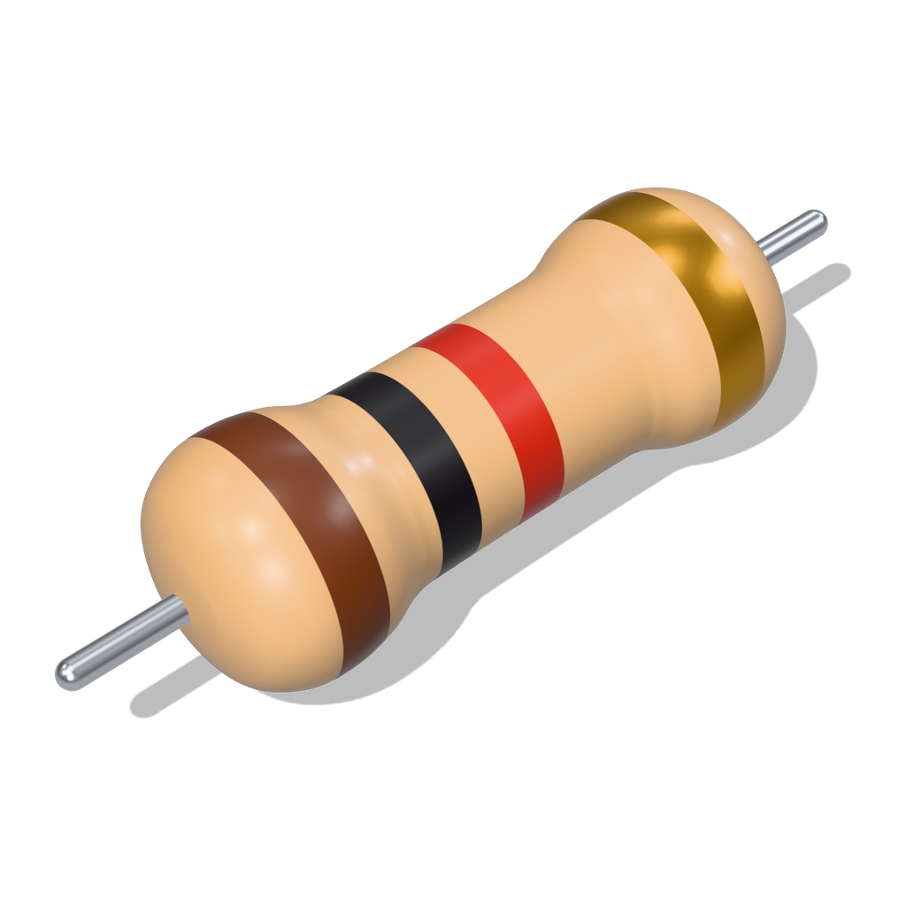
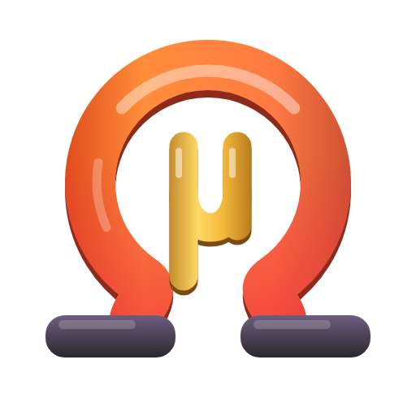
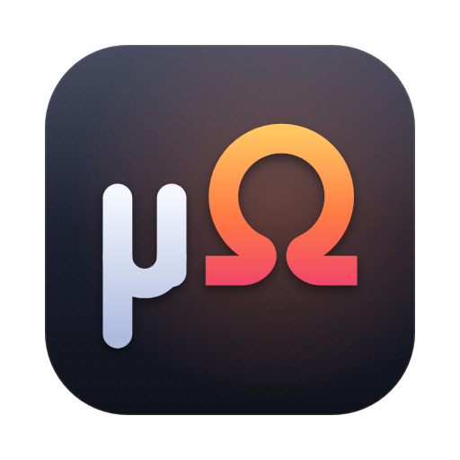
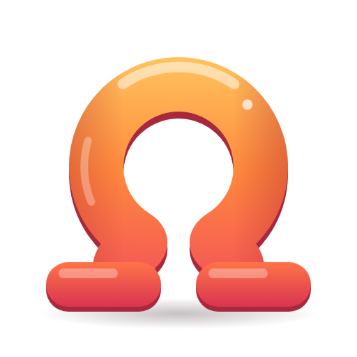

# Icons

## Current icon

A 3D axial resistor (brown, black, red, gold: 1 kΩ ±5%), rendered with three.js.

| File | Used by |
|---|---|
| `micro-harness-manager.icns` | macOS app and DMG (`scripts/package.sh`) |
| `micro-harness-manager.ico` | Windows app and installer, 16 to 256 px |
| `micro-harness-manager.png` | Linux packages; the 1024 px master |
| `app/src/main/resources/…/ui/app-icon.png` | The window and taskbar icon when run from source, 256 px |

All four are generated from [`source/`](source/): edit `scene.js`, then run
`python3 build.py` there (see [source/README.md](source/README.md)). Don't edit the
generated files by hand.

## Earlier designs

Kept for reference; nothing uses them. Each folder has its SVG source and a 512 px
preview.

| | Design | Notes |
|---|---|---|
|  | [1-chibi-micro-ohm](concepts/1-chibi-micro-ohm) | Puffy Ω on plum bases with a gold µ under its arch, in the colours of harness-mgr's torii |
|  | [2-micro-ohm-tile](concepts/2-micro-ohm-tile) | Geometric µΩ monogram on a dark rounded tile; `icon-16.svg` is its Ω-only 16 px cut |
|  | [3-chibi-omega](concepts/3-chibi-omega) | Glossy chibi Ω on pillowy feet, no µ |
|  | [4-chibi-resistor](concepts/4-chibi-resistor) | Flat chibi resistor, the 2D ancestor of the current icon |

To build installers from one of these, render its SVG to the same file set (PNG,
ICO with 16, 24, 32, 48, 64, 128 and 256 px, ICNS, and the 256 px `app-icon.png`).
